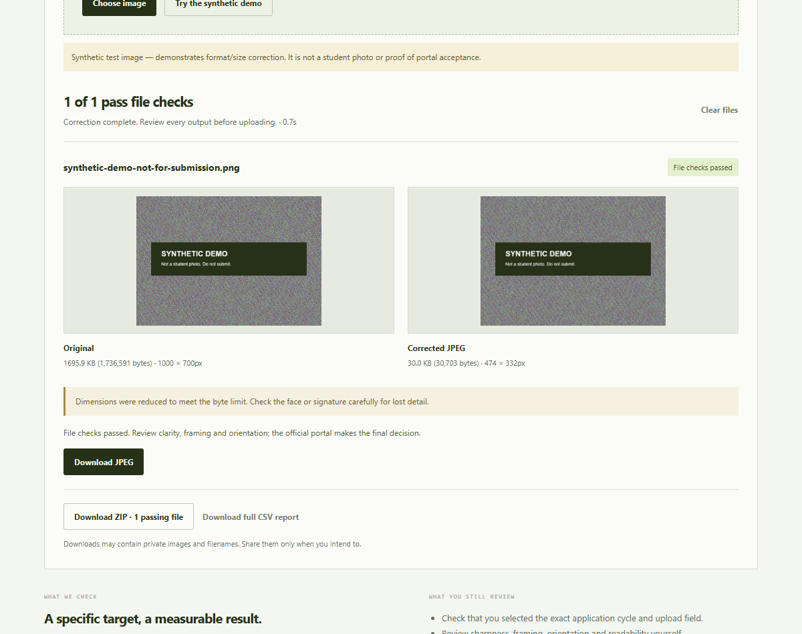
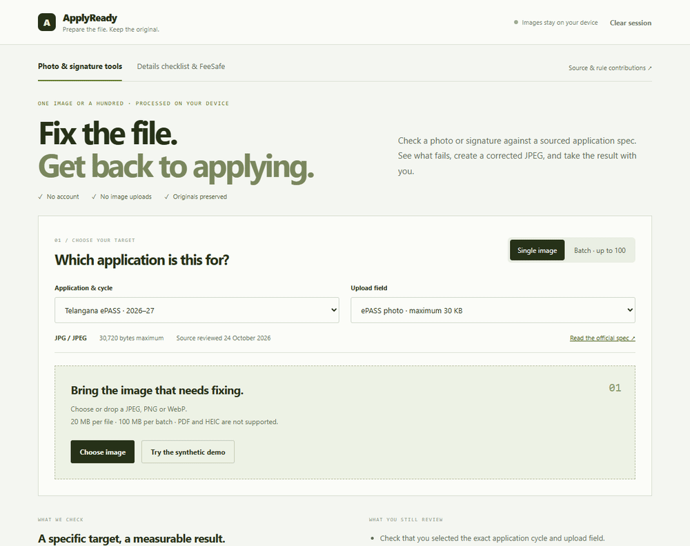

# ApplyReady

**Fix the file. Get back to applying.**

Prepare application photos and signatures against sourced requirements, without sending the images to a server. Diagnose format and size issues, compare the original and prepared JPEG, then download one file or a batch kit.

**[Open the live app](https://applyready-plum.vercel.app/)** · [Contribute a rule pack](CONTRIBUTING.md) · [Pilot and pitch guide](docs/PILOT_AND_PITCH.md)



## A short demo



This recording uses synthetic artwork. It does **not** show a real student's photograph or prove acceptance by a government portal.

## What works

- **Single image:** choose the exact application cycle and upload field, inspect actual decoded format and byte count, correct, visually compare, download JPEG.
- **Batch:** up to 100 images / 100 MB total, processed sequentially against one target. Every file gets a result; passing images go into a ZIP with a CSV report and review instructions. Use separate batches for photos and signatures.
- **Source-backed packs:** versioned JSON with official URLs, page/section references, source-review dates and review-due reminders.
- **Honest failures:** malformed files and impossible size targets stay unresolved. Below-minimum files need better originals; the tool does not pad bytes or fabricate image detail. Already-passing files keep their original contents.
- **Rule feedback:** opt-in public GitHub issue draft containing rule metadata only. No images, filenames or student details are added automatically.
- **Optional details checklist and FeeSafe:** entered-name/DOB consistency, narrowly scoped ePASS checks, private proof checklist and editable factual follow-up letter, separate from the main upload demo.

## Current coverage

| Exact cycle | Image targets | Status |
|---|---|---|
| Telangana ePASS fresh 2026–27 | JPEG photo maximum 30 KB | Published specification, limited coverage |
| TG EAPCET 2026 | JPEG photo below 50 KB; signature below 30 KB | 2026 reference only |
| NEET UG 2026 | JPEG photo 10–200 KB; signature 10–100 KB | 2026 reference only |
| CUET UG 2026 | JPEG photo 10–200 KB; signature 10–50 KB | 2026 reference only |

KB is interpreted as 1024 bytes and exact bytes are displayed. No universal pixel dimensions are invented. Passing file checks does not establish clarity, identity, eligibility, acceptance or admission. Live-photo capture remains a separate official requirement where applicable. **These national exam packs are not verified for 2027.** Published specifications do not mean applications are currently open.

JEE Main 2026 and NEET fingerprint rules are excluded because reviewed sections conflict. See the [source-review ledger](docs/SOURCE_REVIEW.md). Recruitment remains unavailable until a named notification is verified. OCR is deferred pending a separate accuracy evaluation.

## Privacy and operation

Images and entered details remain in this browser session. Clear session resets the workspace; refreshing also loses the session. No account, database, API key, analytics, government login or automatic submission is used. ZIP/CSV/PDF downloads may contain private data; saving and sharing are user actions. Opening an official source or a reviewed feedback draft explicitly navigates to that service.

Automatic correction converts to JPEG and tries quality compression first. If the maximum still cannot be reached, it reduces dimensions proportionally, preserving the composition. Always inspect the result for lost detail. Input supports JPEG/PNG/WebP, up to 20 MB per file, 8192px per side and 40 megapixels. PDF and HEIC are unsupported.

## Run locally

Use Node.js 24 and npm.

```sh
npm ci
npm run dev
```

```sh
npm test
npm run build
npx playwright install chromium
npm run test:e2e
```

On a workstation with Chrome already installed, `PLAYWRIGHT_CHANNEL=chrome` uses it instead of downloading Playwright Chromium. `TEST_BASE_URL` runs browser tests against an existing local or deployed app. The GitHub Actions workflow validates packs, runs unit tests, builds and runs browser tests. It does not deploy automatically.

Vercel build settings: Vite preset, build command `npm run build`, output `dist`, Node 24. The current production release is deployed independently of GitHub; pushing a commit alone does not update the live site.

## Evidence and what remains unproven

The release includes unit checks, real JPEG/ZIP download checks, responsive browser checks, session-cancellation tests and a 100-image batch test with 4× CPU throttling. [Benchmark details](docs/validation/batch-benchmark.json) describe the synthetic fixture and timings. CPU throttling is not a physical low-end-device pilot.

No real student pilot, paying customer, government-portal acceptance recording or "rejections prevented" count has been established. The [pilot worksheet](docs/PILOT_AND_PITCH.md) explains how to collect that evidence without inventing outcomes.

React + TypeScript + Vite; local Canvas processing; JSZip loads only when exporting a kit. See [CONTRIBUTING.md](CONTRIBUTING.md) for rule review, privacy, and current licensing status.
